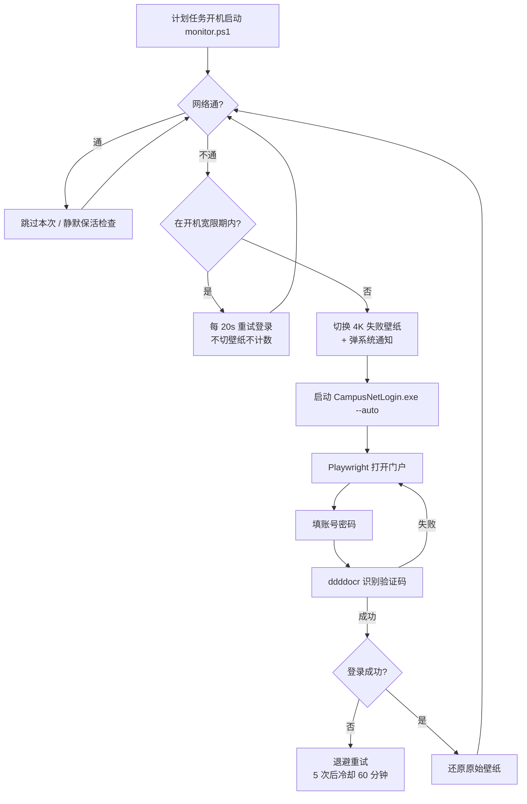

# 校园网自动登录守护（CampusNetLogin）

> Windows 校园网 Portal 认证的自动登录 + 断网守护 + 失败提示壁纸。
> 基于 Python + Playwright 驱动系统 Edge，验证码交给 ddddocr 识别。

[](LICENSE)


---

## 简介

很多学校的校园网需要**打开浏览器 → 访问门户 → 输账号密码 → 过验证码**才能认证上网，
一旦掉线就得手动重来一遍。本项目把这件事彻底自动化：

- 常驻后台**每 5 分钟**探测一次网络，掉线立即自动登录；
- 登录过程用 **Playwright 驱动本机 Edge** 完成（真实浏览器行为，兼容 JS 门户）；
- 验证码用 **ddddocr** 本地 OCR 识别，失败自动换一张重试；
- 断网时把桌面换成一张 **4K 提示壁纸**（写着"连接失败 + 检查清单"），网络恢复后**自动还原你原本的壁纸**；
- 全部行为可在 `config\monitor_settings.json` 里调，配了 11 个双击即用的 `.bat` 快捷入口。

> **本仓库为源码版**。仓库体积约 0.2 MB，不含打包好的 `exe` 与 400 MB 运行库。
> 想要免装 Python 直接运行，请按 [打包为独立 exe](#打包为独立-exe) 自行构建一次。

---

## 功能特性

### 自动登录
- 驱动系统已安装的 **Edge**（`channel="msedge"`），无需额外下载浏览器内核
- 门户账号密码、认证地址、ISP 全部写在配置文件里，改完即生效
- 验证码 OCR 识别失败自动刷新重试，最多 `max_retries` 次
- 支持 `--auto` 命令行模式，供计划任务静默调用

### 守护与保活
- **周期探测**：默认每 300 秒 ping 三个目标（百度 / 腾讯 / B 站）
- **会话保活**：HTTP 会话探测有效时跳过无谓重登；距上次登录超过 2 小时强制保活一次
- **指数退避**：连续失败 5 次进入 60 分钟冷却（退避 300 → 1800 秒），避免冲击认证接口；
  改完密码点保存会**自动重连一次**，不必等冷却（v2.9.4 起）
- **开机宽限期**：监控启动后 150 秒内网络不通视为"网卡/拨号未就绪"，**不误报红屏**，改为每 20 秒重试
- **免打扰时段**：默认 23:00–07:00，时段内一律后台静默、不换壁纸、不弹通知（可配置是否完全停止自动登录）
- **后台静默时段**：默认 07:00–23:00 静默运行、不弹窗

### 失败提示壁纸
- 断网时生成 **4K（长边 3840）** 主题壁纸：主视觉大字 + 右侧"连接失败 / 检查清单"面板
- 多张素材**自动轮替**：内置主题图 + `assets\` 下的自定义图依次上场
- 自定义壁纸支持两种版式，**都完整显示原图、不裁边、不拉伸**：
  - `theme_xxx.jpg` → 白底金框卡片，摆在左侧
  - `theme_full_xxx.jpg` → 整图居中大图（金框 + 投影）
- 换壁纸前**先记下你原本的壁纸**，网络恢复后原样还原
- **状态自愈**：任何一次检测到网络正常都会撤掉红屏，不必等下一次登录成功

### 运维与清理
- 磁盘占用**封顶**：`monitor.log` 2 MB×4、`login_steps.log` 1 MB、截图 40 张 / 7 天
- 每次清理回收 `%TEMP%` 下本程序的 PyInstaller 解压残留（`_MEI*`），被占用则改名隔离下次再删
- **单实例**：心跳文件（PID + 时间戳）判定，重复启动安全退出；心跳超时自动接管僵死实例
- **一键恢复初始状态**：三档力度，可从"装了半年"回到"刚解压"的样子

### 开发者标志
- 内置《甄嬛传》主题标识（`[甄嬛传]` 日志前缀、紫色失败壁纸 + 黄色 DEV 角标、启动横幅）
- **写死在源码里，无开关、无配置项**，仅作"这是开发者自己的环境"的视觉标记，不影响任何登录与监控行为

---

## 工作原理



---

## 技术栈与依赖

| 组件 | 用途 | 构建环境版本 |
|---|---|---|
| [Playwright](https://playwright.dev/python/) | 驱动 Edge 完成门户登录 | 1.63.0 |
| [ddddocr](https://github.com/sml2h3/ddddocr) | 验证码本地 OCR | 1.6.1 |
| [onnxruntime](https://onnxruntime.ai/) | ddddocr 推理后端 | 1.30.0 |
| [opencv-python](https://pypi.org/project/opencv-python/) | 图像预处理 | 5.0.0.93 |
| [numpy](https://numpy.org/) | 数组运算 | 2.5.3 |
| [Pillow](https://python-pillow.org/) | 图像处理 | 12.3.0 |
| [psutil](https://github.com/giampaolo/psutil) | 进程查询与清理 | 7.2.2 |
| [pywin32](https://github.com/mhammond/pywin32) | Windows 注册表 / 窗口控制 | 312 |
| PowerShell 5.1 | 监控主循环、壁纸渲染（`System.Drawing`） | Windows 内置 |
| Python | 运行主程序 | 3.13.14 |
| [PyInstaller](https://pyinstaller.org/) | 打包 exe（仅构建时需要） | 6.22.3 |

- **运行平台**：Windows 10 / 11（依赖计划任务、`SystemParametersInfo`、Edge）
- **运行依赖**：系统已安装 Microsoft Edge，以及 PowerShell 5.1（系统自带）

---

## 目录结构

```
校园网\
├─ README.md                 本文件
├─ LICENSE                   MIT
├─ .gitignore
├─ VERSION                   版本号
│
├─ 安装.bat                  ← 安装/重新注册守护（需右键「以管理员身份运行」）
├─ 卸载.bat                  移除守护
├─ 检查状态.bat              全面自检（依赖、任务、进程、占用、日志）
├─ 立即重连.bat              立刻执行一次登录
├─ 设置账号密码.bat           图形化改账号密码（密码框掩码）
├─ 设置免打扰.bat             自定义免打扰时段与后台静默时段
├─ 暂停监控.bat / 恢复监控.bat 临时停用 / 恢复自动登录
├─ 清理维护.bat              清理过期文件（常规 / 演练 / 强制 三档）
├─ 恢复初始状态.bat           回到「刚解压」的状态（三档力度）
├─ 还原壁纸.bat              立即还原被改写的桌面壁纸
│
├─ bin\
│   └─ campus_net_config.json    ★ 账号密码与登录配置（exe 按自身目录查找）
│
├─ assets\                       失败壁纸素材（可自行增删）
│   ├─ SOURCES.txt               素材来源与版权说明 + 使用规则
│   ├─ theme_01.jpg              → 卡片版式
│   └─ theme_full_xxx.jpg        → 整图居中版式（自己放进去即生效）
│
├─ config\
│   └─ monitor_settings.json     ★ 监控行为配置（探测、退避、免打扰、清理…）
│
├─ scripts\                      PowerShell 脚本
│   ├─ monitor.ps1               常驻监控主循环 + 4K 壁纸渲染
│   ├─ install.ps1 / uninstall.ps1
│   ├─ status.ps1 / set_account.ps1
│   ├─ pause.ps1 / reconnect.ps1
│   ├─ set_quiet_hours.ps1
│   ├─ cleanup.ps1               清理与归档
│   ├─ reset.ps1                 恢复初始状态
│   └─ restore_wallpaper.ps1
│
├─ src\                          Python 源码
│   ├─ campus_net_login.py       主程序
│   ├─ build.spec                PyInstaller 打包配置（onedir）
│   ├─ requirements.txt          依赖清单
│   └─ README.md                 源码还原过程与验证记录
│
└─ docs\
    ├─ 使用说明.txt              完整用户手册
    ├─ 技术说明与已知限制.md      ★ 配置读取机制、已知问题清单与根因分析
    └─ 功能完整性复查报告.md
```

> **运行期才会出现的目录**（不在仓库里）：`logs\`（日志）、`shots\`（登录截图）、
> `bin\_internal\`（打包后的运行库）、`config\` 下的心跳与壁纸状态文件。

---

## 快速开始

### 1. 环境要求

- Windows 10 / 11，已安装 **Microsoft Edge**
- **Python 3.13**（[下载](https://www.python.org/downloads/)）
- 能访问你的校园网门户（未认证时通常也能访问）

### 2. 安装依赖

```bat
cd src
pip install -r requirements.txt
```

> `playwright` 这里只用于调用**系统已装的 Edge**，无需执行 `playwright install` 下载内核。

### 3. 配置账号

编辑 `bin\campus_net_config.json`（也可双击 `设置账号密码.bat` 用图形界面改）：

```json
{
  "campus_network": {
    "account": "你的学号",
    "password": "你的密码",
    "login_url": "http://2.2.2.2",
    "isp": "天翼校园网"
  },
  "test_url": "https://www.bilibili.com",
  "bilibili_url": "https://www.bilibili.com",
  "max_retries": 3,
  "wait_after_login_seconds": 120,
  "browser": "edge"
}
```

| 字段 | 说明 |
|---|---|
| `account` / `password` | 校园网账号与密码（**明文存储**，见 [免责声明](#免责声明)） |
| `login_url` | 门户地址。多数学校是 `http://2.2.2.2`，**请改成你学校的** |
| `isp` | 运营商下拉框文本（校园网 / 天翼 / 联通 / 移动），按门户文案填写 |
| `test_url` | 判定"网络是否通畅"的探测地址 |
| `bilibili_url` | 登录成功后自动打开的页面（可改成任意网址，也可留空） |
| `max_retries` | 单次登录的验证码重试上限 |
| `wait_after_login_seconds` | 登录后停留观察时间（秒） |
| `browser` | 使用哪个浏览器内核，默认 `edge` |

> 仓库里这份配置的账号密码是占位值 `"0"`，**必须改成你自己的**才能登录。

### 4. 运行

```bat
python campus_net_login.py            :: 交互菜单
python campus_net_login.py --auto     :: 自动模式（计划任务用的就是这个）
```

或者直接双击 `安装.bat`（**右键 → 以管理员身份运行**）注册开机计划任务，
之后由 `scripts\monitor.ps1` 常驻守护。

### 5. 移动文件夹后必须重装

计划任务里记录的是 `monitor.ps1` 的**绝对路径**。文件夹一旦移动，
任务会指向失效路径，自动登录会**静默停止**。
移动后请重新右键 `安装.bat` → 以管理员身份运行。
用 `检查状态.bat` 可确认是否提示"计划任务仍指向旧路径"。

---

## 打包为独立 exe

仓库不含打包产物，需要免 Python 运行请自行构建：

```bat
cd src
pip install pyinstaller
pyinstaller build.spec
```

产物在 `src\dist\CampusNetLogin\`，把它整个（`CampusNetLogin.exe` + `_internal\`）
复制到 `bin\` 下覆盖即可。

> **本配置使用 onedir 而非 onefile**：原先的 onefile 每次启动都要把 187 MB 解压到
> `%TEMP%\_MEI*`（实测占 274～387 MB），单次登录常超过 3 分钟，进程被挂起时残留不会清理。
> onedir 就地加载，冷启动与磁盘占用都明显更低。
>
> ⚠️ `CampusNetLogin.exe` 与 `_internal\` **必须放在同一目录**，只拷 exe 无法启动。

---

## 操作手册

全部入口都是双击即用的 `.bat`（除安装/卸载/恢复初始状态外均无需管理员权限）：

| 快捷方式 | 作用 | 何时用 |
|---|---|---|
| `安装.bat` | 注册开机计划任务并启动监控 | 首次使用、移动目录后、升级后 |
| `卸载.bat` | 停止监控并移除计划任务 | 不再需要时 |
| `检查状态.bat` | 全面自检：依赖、任务、进程、心跳、产物占用 | 觉得"没生效"时先跑这个 |
| `立即重连.bat` | 立刻触发一次登录（**不受免打扰限制**） | 手动救急 |
| `设置账号密码.bat` | 图形化改账号密码，保存即生效 | 换密码后 |
| `设置免打扰.bat` | 改免打扰时段 / 后台静默时段 / 是否完全停登录 | 晚上不想被吵 |
| `暂停监控.bat` | 暂停自动登录（保留检测） | 离校、长假 |
| `恢复监控.bat` | 恢复自动登录 | 回来后 |
| `清理维护.bat` | 三档清理：1 常规 / 2 演练（只报告）/ 3 强制 | 磁盘紧张时 |
| `恢复初始状态.bat` | 三档重置，可回到"刚解压" | 转手 / 重装系统前 |
| `还原壁纸.bat` | 立即还原被改写的桌面壁纸 | 红屏没自动褪去时 |

### 常用流程

```
首次使用：  安装.bat(管理员) → 设置账号密码.bat → 检查状态.bat
日常排障：  检查状态.bat → 看 logs\monitor.log 尾部
临时停用：  暂停监控.bat → （回来）恢复监控.bat
彻底重置：  恢复初始状态.bat → 选 3 彻底重置 → 重新 设置账号密码.bat + 安装.bat
```

---

## 配置说明

### `config\monitor_settings.json`

| 段 | 关键项 | 说明 |
|---|---|---|
| `background_window` | `start` / `end` | 后台静默时段，默认 `07:00`–`23:00` |
| `quiet_hours` | `enabled` / `start` / `end` / `skip_auto_login` / `mute_notify` | 免打扰，支持跨午夜；`skip_auto_login=false` 表示仍静默保活 |
| `startup` | `grace_sec` / `retry_interval_sec` | 开机宽限期，默认 150 秒，设 `0` 关闭 |
| `ping` | `targets` / `count` / `timeout_ms` / `interval_sec` | 网络探测，默认 300 秒一轮 |
| `session_probe` | `enabled` / `url` / `interval_sec` / `force_relogin_hours` | 会话探测，默认 1 小时一次、2 小时强制保活 |
| `retry` | `consecutive_failures_before_cooldown` / `cooldown_minutes` / `backoff_base_sec` / `backoff_max_sec` | 退避与冷却 |
| `exe` | `wait_ms` / `hide_edge_interval_sec` | 登录程序超时与 Edge 窗口隐藏 |
| `notify` | `wallpaper` / `toast` | 是否换壁纸、是否弹通知 |
| `cleanup` | `interval_hours` / `shots_keep_days` / `shots_max_files` / `logs_keep_days` / `login_steps_max_bytes` / `temp_mei` | 清理与占用封顶 |
| `log` | `max_bytes` / `keep` / `heartbeat_every_sec` | 日志轮转与心跳周期 |

> 该文件**只在监控启动时读取**，改完需重启监控（`设置免打扰.bat` 会自动询问要不要重启）。

### 失败壁纸定制

把自己的图丢进 `assets\`，按文件名前缀自动选版式，**放进即生效，不必重启监控**：

| 命名 | 效果 |
|---|---|
| `theme_xxx.jpg` | 白底金框**卡片**，摆在左侧，按原图像素摆放 |
| `theme_full_xxx.jpg` | **整图居中**大图（金框 + 投影），不裁不放 |

- 支持 `.jpg / .jpeg / .png / .bmp`，和内置素材一起轮流上场，删掉文件即自动跳过
- 卡片下方说明文字自动取 `assets\SOURCES.txt` 中该文件名的条目，没写则显示「自定义素材 · 文件名」
- 小图不做有损放大（卡片最多 1.25 倍、整图模式一律不放大）；想铺满就换高分辨率大图

---

## 常见问题

**Q：为什么 `CampusNetLogin.exe` 和 `_internal\` 必须放在一起？**
A：onedir 打包的 exe 会去同目录 `_internal\` 加载依赖。只拷 exe 会启动失败。
同理 `campus_net_config.json` 也按 exe 自身所在目录查找，移走会导致登录失效且无报错。

**Q：密码是明文存的吗？**
A：是，保存在 `bin\campus_net_config.json`。**请勿把填了自己密码的整个文件夹外传**，
提交到 Git 前务必先 `git status` 确认。

**Q：一开机就变成红屏提示壁纸？**
A：已内置 150 秒**开机宽限期**，此期间网络不通不切壁纸、不计数。
若仍出现，把 `startup.grace_sec` 调大（例如 300）。

**Q：换了学校 / 门户改版了怎么办？**
A：改 `login_url` 与 `isp`；若门户 DOM 结构变化，需要调整 `src\campus_net_login.py`
里的元素定位逻辑，改完重新打包。

**Q：清理会不会删掉我的文件？**
A：只清理 `shots\`、`logs\` 和确认为本程序产物的 `%TEMP%\_MEI*`（且至少存在 6 小时）。
不放心就先跑 `清理维护.bat` 选 **2 演练**，它只报告不删除。

**Q：监控好像没在跑？**
A：跑 `检查状态.bat`。计划任务指向旧路径（移动过文件夹）、心跳文件停更
（实例卡死）都会在这里显示出来。


**Q：改了密码，为什么程序不及时重试？**
A：**v2.9.4 起已修复：改完密码点保存，程序会自动重连一次（通常 10 秒内）**——
监控若没在运行，保存时还会自动把它拉起来。**不需要重装，也不需要重启电脑。**

（v2.9.3 及以前为什么会慢：监控在连续登录失败后会进入指数退避与冷却——
第 1~4 次失败后分别等 5 / 10 / 20 / 30 分钟再试，第 5 次起进入 **60 分钟冷却**，
此后固定每小时才试一次。这段计时状态存在监控进程的**内存**里，改配置文件不会打断它，
所以最长要等约 60 分钟。老版本的手动解法：改完密码后再双击一次 `立即重连.bat`，
它立刻用新密码试一次，**不受退避 / 冷却 / 暂停 / 免打扰限制**，通常 10 秒内响应。）

登录 exe 每次启动都会重新读配置，所以“新密码没被读到”这种情况并不存在。
完整机制与时间表见 [`docs\技术说明与已知限制.md`](docs/技术说明与已知限制.md) 第 2 节。

---

## 版本历史

| 版本 | 主要变化 |
|---|---|
| v2.1 | 目录分层重构；从 exe 还原出 Python 源码；新增自动清理 |
| v2.1.1 | 壁纸先备份再改写，恢复时还原原始壁纸 |
| v2.1.2 | 心跳式单实例，僵死实例自动接管 |
| v2.2.0 | 打包方式 onefile → **onedir**，不再往 `%TEMP%` 解压 |
| v2.3.0 | 自定义免打扰时段（支持跨午夜） |
| v2.4.0 | 壁纸状态自愈 + 开机宽限期（治"一开机就红屏"） |
| v2.5.0 | 磁盘占用封顶；一键恢复初始状态 |
| v2.7.0 | 开发者标志（甄嬛传） |
| v2.8.0 | 失败壁纸改为 4K 高清主题图 + 连接失败检查面板 |
| v2.9.0 | 素材轮替（`assets\` + 轮替游标） |
| v2.9.1 | 修复「密码修改不了」：`File.Replace` 传 `$null` 被 PowerShell 转成空串导致 `The path is not of a legal form.` |
| v2.9.2 | 自定义壁纸支持整图铺底；说明文字不再误用他人剧照文案 |
| v2.9.3 | 自定义壁纸改为**完整显示原图**（卡片 / 整图居中两种版式），不裁边、不做有损放大 |
| **v2.9.4** | 修复「改完密码要等最长 60 分钟才生效」：保存后自动重连，且手动重连会把退避/冷却节奏归零 |

---

## 免责声明

- 本项目仅供**个人自动化**使用。请遵守你所在学校的校园网使用规定，
  不要用于账号共享、批量刷号等违规行为。
- 账号密码以**明文**保存在 `bin\campus_net_config.json`，请自行妥善保管本目录，
  不要上传到公开仓库或分享给他人。
- 本仓库中的账号密码为占位值 `"0"`，不含任何真实凭据。
- 若门户改版或 Edge 大版本更新导致失效，需要自行调整源码重新打包。

---

## License

[MIT](LICENSE) © 2026 ysh999999999
